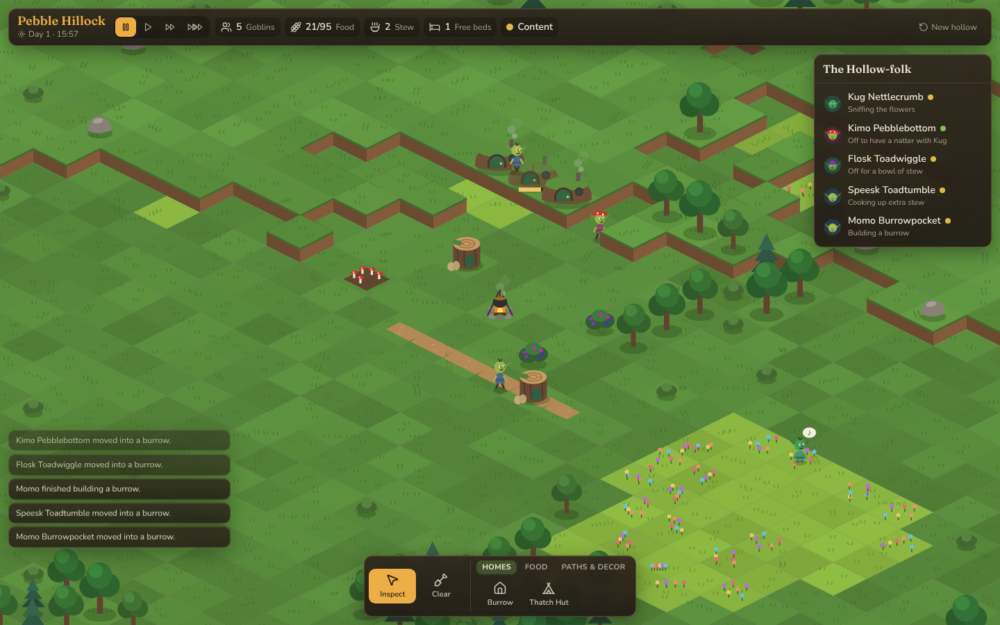
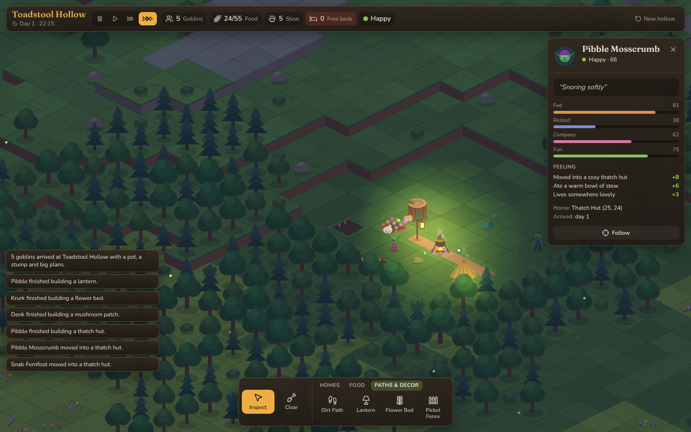

# Goblin Hollow

A cozy isometric community sim. You lay out a hillside village (burrows, huts, mushroom patches, cookfires, paths and lanterns) and a little band of goblins lives in it: they get hungry, sleepy, lonely and bored, and decide for themselves how to look after each other.

<table>
<tr>
<td width="50%"></td>
<td width="50%"></td>
</tr>
<tr>
<td align="center">Burrows dug into the hill, a stew pot on the go</td>
<td align="center">Lanterns and the cookfire after dark</td>
</tr>
</table>

Built on the scaffold of [IsoCity](https://github.com/amilich/isometric-city) (Next.js, TypeScript, HTML5 Canvas). The city and theme-park games have been removed; the Next.js shell, UI kit and isometric approach remain.

## Playing

- **Inspect** (default): click a goblin or building to see what's going on; drag to pan, scroll or pinch to zoom.
- **Build**: pick something from the bar at the bottom and click a tile. Goblins come and build it themselves.
  - *Homes*: **Burrow** (must be dug into a hill, sleeps 3) and **Thatch Hut** (flat ground, sleeps 2).
  - *Food*: **Mushroom Patch**, **Berry Bush**, **Cookfire** (goblins cook stew here and eat together) and **Larder Stump** (+40 storage).
  - *Paths & Decor*: **Dirt Path** (faster walking, drag to paint), **Lantern**, **Flower Bed**, **Picket Fence**.
- **Clear**: remove trees, rocks, paths or buildings.
- Keys: `Space` pause · `1` `2` `3` speed · `WASD`/arrows pan · `Esc` back to inspect.

The hollow autosaves to your browser every 20 seconds. **New hollow** generates a fresh map from a new seed.

## How the goblins work

Each goblin has four needs — **Fed**, **Rested**, **Company** and **Fun** — that drain over the day. Every so often a goblin scores what it could do and picks the most pressing thing:

| Need | What they do about it |
| --- | --- |
| Fed | Eat stew at a cookfire (best, and social), raw food from the larder, or forage for grubs if the stores are bare |
| Rested | Sleep at home (snug) or on the ground (cold and grumpy), mostly at night |
| Company | Wander over to another goblin for a natter |
| Fun | Cloud-watch from a hilltop, paddle in the stream, smell flowers, nap in the sun, or bask by lanterns at night |
| *(village)* | Build blueprints, harvest ripe crops, haul food to larders, cook stew |

**Mood** blends their needs with short-lived *moodlets* ("Ate a warm bowl of stew +6", "Slept on the cold ground −8", "Lives somewhere lovely +3"). Happier goblins walk and work faster; miserable ones go off to sulk. If the village is content, has spare beds and food, new goblins wander in each morning.

## Code map

```
src/games/goblins/      simulation & rendering (no React)
  catalog.ts            buildings, tiles, timing constants, placement rules
  worldgen.ts           seeded hillside map: hills, stream & fords, woods, meadows
  goblin.ts, names.ts   procedural goblins (looks + names)
  sim.ts                Hollow engine: needs, moodlets, utility-AI decisions, jobs
  pathfinding.ts        A* over tiles (paths cheap, fords slow, cliffs blocked)
  render.ts             canvas renderer: terrain, buildings, goblins, day/night light
  save.ts               localStorage save (lz-string compressed)
src/components/goblins/ React UI: canvas host, input, HUD panels
```

In the browser console, `goblinHollow()` returns the live engine for tinkering.

## Roadmap

- **Phase 1 — the hollow lives** ✅ terrain, building, needs & mood, day/night, saves
- **Phase 2 — who they are**: stats, personality traits, skills/jobs, aging
- **Phase 3 — who they love**: friendships, rivalries, romance, families
- **Phase 4 — the chronicle**: life events and character development as a readable story
- **Phase 5 — polish**: seasons, festivals, sound, more buildings

## Development

```bash
npm install
npm run dev     # http://localhost:3000
npm run build   # production build (also type-checks)
npm run lint
```

MIT licensed (see `LICENSE`), as is the IsoCity scaffold it grew from.
